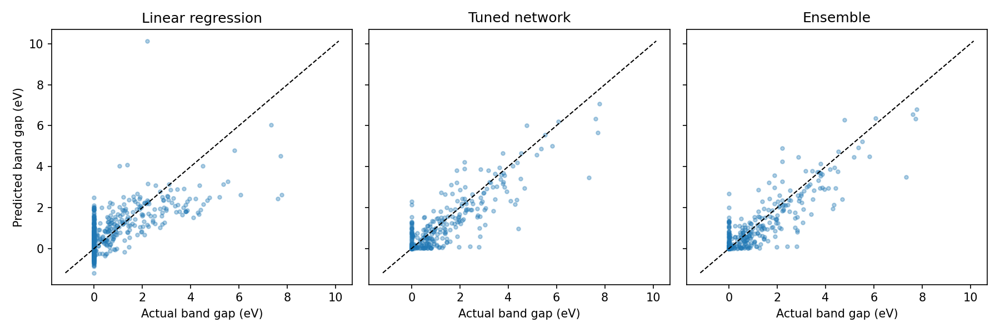
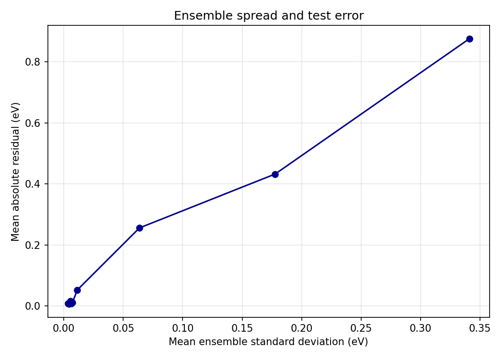

# Predicting band gaps from materials features

AI SCI 290A · Project 1 · Mitchell Geringer

**Video** · [5-minute summary](https://docs.google.com/videos/d/1bAs50yc4pxecqka86IT5R-gKq5YOgES2DJNAnY_w8Eo/edit?usp=sharing)

## Research question

How well can a neural network predict a material's band gap from features derived from its composition and crystal structure? This project compares a linear regression baseline with feed-forward networks, tests how performance changes when fewer features are used, and measures whether disagreement among ensemble members tracks prediction error.

## Data

The course feature cache in [`data/features_1or2_stable.pkl`](data/features_1or2_stable.pkl) is a featurized subset of stable materials with one or two elements from the [Materials Project](https://materialsproject.org/). The course prepared the cache using materials descriptors from [matminer](https://hackingmaterials.lbl.gov/matminer/). The prediction target is the computed band gap in electron-volts (eV).

After dropping entirely missing columns and rows with missing features, 5,131 materials and 141 features remain. About 78% of the materials have a reported gap of 0 eV. The analysis uses a fixed 60/20/20 train, validation, and test split and fits the robust scaler and feature selector on training data. The cache is included for use in this private repository. Running the project with this cache requires no Materials Project API key.

## Results

| Model | Test RMSE (eV) |
| --- | ---: |
| Linear regression | 0.719 |
| Tuned feed-forward network | 0.434 |
| Ensemble of 10 networks | 0.429 |

The tuned network substantially reduced error relative to linear regression. Averaging ten networks trained with different seeds gave a smaller further reduction. The ensemble's prediction spread is used as an uncertainty score and is compared with absolute residuals.





## Run the analysis

From the repository root, create and activate the Conda environment.

```bash
conda env create -f environment.yml
conda activate quantum-material-properties
python run.py
```

The default run reproduces the notebook's feature subset comparison, one-at-a-time hyperparameter scans, and final benchmarks. The final benchmark uses the notebook's selected settings. The script saves plots to `figures/` and CSV tables and run metadata to `results/`.

For a faster run of just the final benchmarks, use the following commands.

```bash
python run.py --skip-scans
python run.py --help
```

Open [`quantum_material_props.ipynb`](quantum_material_props.ipynb) with `jupyter lab` from the activated environment for the exploratory walkthrough.

## Repository layout

| Path | Purpose |
| --- | --- |
| `run.py` | Runs the experiments and saves the outputs |
| `src/data.py` | Loads, cleans, splits, and scales the dataset |
| `src/model.py`, `src/train.py` | Define and train the PyTorch regressor |
| `src/plots.py` | Contains plotting functions used in the notebook and command-line workflow |
| `figures/` | Prediction and uncertainty plots |
| `results/` | Validation and test metrics, uncertainty bins, and run settings |
